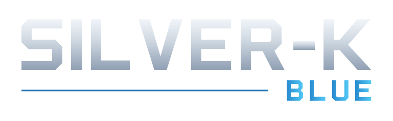

# Silver-K Blue

A [temaniak/Silver-K](https://github.com/temaniak/Silver-K) nem hivatalos, saját Blue Standard és Blue Retina 4K felülettel továbbfejlesztett változata. Az eredeti szerzők munkájára épül; dokumentált alapja v0.4.4a.

## Letöltések

| Platform | Formátumok | Letöltés |
| --- | --- | --- |
| Windows x64 | VST3, Standalone | Még nincs új kiadás |
| macOS Universal 2 | AU, VST3, Standalone; arm64 + x86_64 | Még nincs új kiadás |

A korábbi külön platformkiadások törölve lettek. Új közös Windows/macOS/forrás kiadás még nincs publikálva. A sikeres futások build-artifactjai bejelentkezve a [GitHub Actions](https://github.com/RobCZart82/Silver-K-Blue/actions) oldalon érhetők el; minden futásnál látható a pontos forráscommit. Ezek CI-csomagok, nem publikált kiadás vagy teljes használati/hangteszt igazolása.

## Telepítés és használat

Mindkét skin be van építve, a Setup listából választható. Új beállításnál a Retina az alapértelmezett; a mentett választás megmarad. A külső Skins mappa opcionális.

A Blue és az eredeti Silver-K pluginazonosítója azonos. Zárd be a hostot, mentsd a korábbi teljes plugint a beolvasott mappákon kívülre, és a teljes bundle-t cseréld. Ne maradjon két azonos példány a host keresési útvonalán.

Saját kompatibilis firmware szükséges; KS módban Wave ROM és program/performance MIDI-adat is kell. A nulla Wave ROM nem tartalmaz mintahullámokat. Gyártói firmware-t és gyári hangadatot nem mellékelünk. A macOS minimumcél 12.0; a build ad hoc aláírt és nem notarizált. A Windows build nincs tanúsítvánnyal aláírva.

- [Magyar telepítési útmutató](blue/Documentation/01-Telepites-es-hasznalat.md)
- [Angol telepítés](doc/INSTALL.md), [használat](doc/USER_GUIDE.md), [fordítás](doc/BUILD.md)
- [Fejlesztési napló és publikálási terv](blue/Documentation/11-Fejlesztesi-naplo-es-publikalasi-terv.md)
- [Változásjegyzék](CHANGELOG.md)

A Standard külső skin upstream v0.4.4a-val is használható. A Retina nagyobb képeihez Blue-kompatibilis bináris kell. A napi upstream-ellenőrzés külön javaslati ágat készít; nem olvaszt automatikusan main-be és nem publikál kiadást.

Forráslicenc: [GPLv3](LICENSE.md); [eredet és függőségek](THIRD_PARTY.md); [grafikai eredet és nyitott ellenőrzések](blue/Artwork/PROVENANCE.md). A történeti dokumentumok korábbi helyi csomagokra utalhatnak.

## Mappák és fájlok

- **ROMs:** firmware, Wave ROM és **KS All Data.MID** (KS program/performance indítóadat).
- **Patches és almappái:** további presetek, programok és bankok.
- **Skins:** külső skin-csomagok külön közvetlen almappákban; a beépített Blue skinekhez nem szükséges.

[Részletes keresési és betöltési szabályok](doc/DATA_FOLDERS.hu.md).
