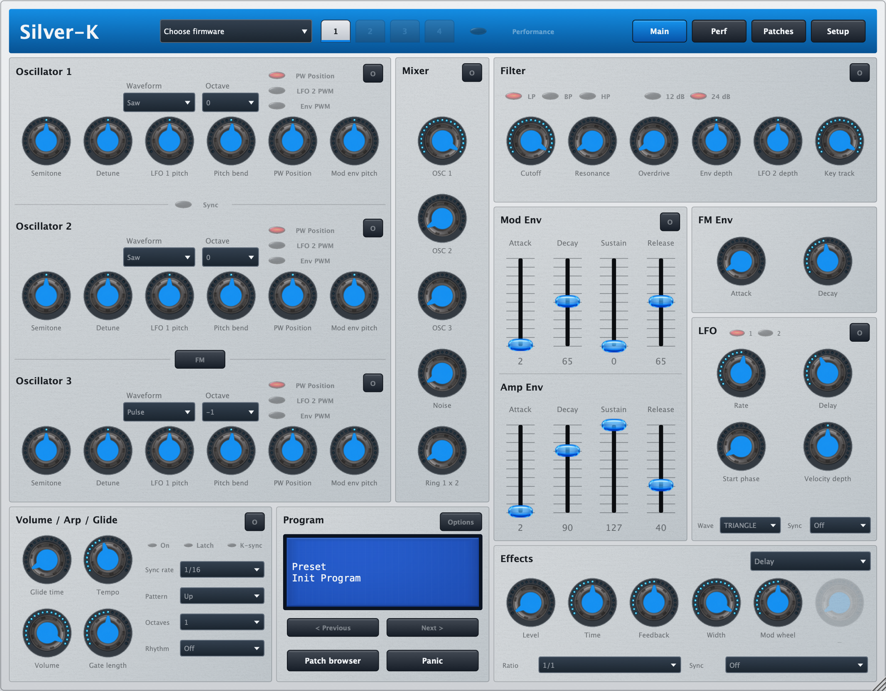
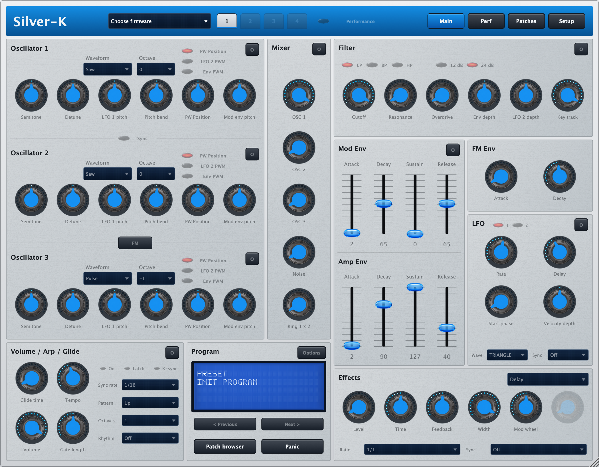

An unofficial [Silver-K](https://github.com/temaniak/Silver-K) variant with integrated **Blue Standard** and **Blue Retina 4K** skins and additional interface changes.

Built on the work of the Silver-K, ungeermoolator and Gearmulator authors. This is an independently maintained variant, not an official upstream release. The documented upstream base is **v0.4.4a**, commit `4baaead06e23e2358729cca32b6b511c72022318`.

[Magyar útmutató](README.hu.md) · [Installation](doc/INSTALL.md) · [User guide](doc/USER_GUIDE.md) · [Build](doc/BUILD.md) · [Changes](CHANGELOG.md)

## Downloads

| Platform | Formats | Current download |
| --- | --- | --- |
| Windows x64 | VST3, Standalone | [Windows build 3](https://github.com/RobCZart82/Silver-K-Blue/releases/tag/windows-blue-3-1) |
| macOS Universal 2 | AU, VST3, Standalone; Apple Silicon + Intel | [macOS build 2](https://github.com/RobCZart82/Silver-K-Blue/releases/tag/macos-blue-2-1) |

Both packages were built from `40b68eeebd8e2c7d4a92229aa25fcb1217a652cc`. They are test builds. The framework fixes proposed in [PR #1](https://github.com/RobCZart82/Silver-K-Blue/pull/1) are **not included** in these downloads. See each release for its exact validation and use the supplied SHA-256 file to verify the download.

macOS builds target 12.0 or later and are ad hoc signed, not notarized. Windows builds are unsigned. Build success does not establish interactive DAW/audio acceptance on every platform or physical Intel Mac.

## The Blue interface

- **Standard v1.0:** 64 px rotary frames; the external skin is compatible with upstream v0.4.4a.
- **Retina 4K v1.0:** 256 px rotary frames and high-resolution faders, with Blue-specific image loading support.
- Blue LED arcs, aluminium panels, navy LCD backgrounds and a four-line main dot-matrix display.
- Both skins are embedded in all current Blue products; no separate skin installation is required.
- New settings default to Retina. Previously saved choices and external skins remain supported.

Actual plugin renders from the integration source (`9004549`), captured at 2× scale without firmware; unavailable controls are therefore dimmed. These are UI previews, not audio acceptance tests.

**Standard**

**Retina 4K**

The source skin packages are in [blue/Skins](blue/Skins). Retina requires a compatible Blue binary; it cannot be used as an unchanged external skin with upstream v0.4.4a.

## Installation and first startup

**Blue uses the same plugin identity as Silver-K.** Close the host, back up the previous complete plugin outside all host scan folders, then replace the whole bundle. Avoid duplicate copies in scanned folders. Follow the [installation guide](doc/INSTALL.md).

**Supply your own compatible firmware.** K-Station uses its own firmware. KS additionally requires compatible program/performance MIDI data and Wave ROM. The automatically created zero Wave ROM supports generated oscillator waves; sampled-wave sounds may be incomplete or silent. Proprietary firmware and factory sound data are not included.

In Standalone select your audio device and MIDI input. In a DAW enable instrument-track monitoring. See [first startup](doc/USER_GUIDE.md#first-startup).

## Development

Build instructions cover Windows x64 and macOS Universal 2. Dependencies are fetched from pinned revisions at the first configuration. Tests without ROM data and firmware-dependent acceptance checks have different scopes; record skipped tests explicitly.

The daily [upstream check](blue/Documentation/08-Upstream-frissites.md) prepares a separate review branch when changes are available. A maintainer opens and reviews a PR; the automation never merges main or publishes a release. It supports both private and public visibility for this repository.

[Development plan and log (Hungarian)](blue/Documentation/11-Fejlesztesi-naplo-es-publikalasi-terv.md) · [Public release preparation](doc/PUBLICATION.md)

For bug reports include the build commit, OS, host/version, format, engine mode, reproduction steps and whether the issue occurs with Standard or Retina. Do not attach proprietary firmware, factory data or private session files.

## Source and credits

Source code: [GPLv3](LICENSE.md). Original notices are preserved. [THIRD_PARTY.md](THIRD_PARTY.md) describes source and dependency provenance; [Blue artwork provenance](blue/Artwork/PROVENANCE.md) records the remaining artwork review.

The generated [ks-init-flash asset](assets/README.md) is synthetic initialization/test data, not a manufacturer ROM. Historical design and archive notes are retained as history, not current installation instructions.
